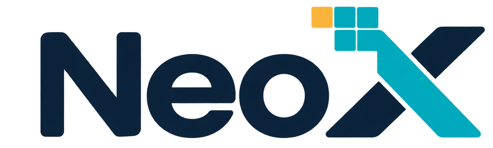

# NeoX

<p align="center"></p>

NeoX 是一个以**图形语义契约**为中心的跨平台 2D 图形库：矢量路径、位图、文字与图层合成。它是 NeoSDK（2003–2007，DOS 时代的 C 语言图形库）的精神续作——不继承其接口，但继承其"头文件级简洁、源码全开放"的美学。

**English**: NeoX is a cross-platform 2D graphics library built around a verifiable graphics-semantics contract: vector paths, bitmaps, text and layer compositing, with multiple execution backends (software rasterizer + GPU) proven consistent against a single specification.

## 设计要点

- **三个独立契约**：图形语义（SD）、内部执行表示（ER，后端私有）、捕获/传输格式（CAP）。正常本地绘制不经过序列化。
- **立即模式与保留模式同为前端**：立即 API 与保留场景树汇入同一执行系统；录制、保留、增量执行是三个分开的能力。
- **明确的失败语义**：后端无法忠实执行时明确失败，近似执行须显式授权且可在正式构建中查询实际执行路径。
- **资源受限环境友好**：注入分配器、可固定内存预算、核心不创建线程也不假设线程存在，目标覆盖桌面、移动、浏览器（WASM）与嵌入式。
- **可验证性**：同一内容经立即/保留两条路径、经不同后端执行，结果须满足规范容差（当前 Soft 与 GL 后端**逐位一致**）。

详见 [docs/design-v0.2.md](docs/design-v0.2.md)（方案文档）、[docs/semantics-v0.md](docs/semantics-v0.md)（语义规范）与 [docs/adr/](docs/adr/)（架构决策记录）。

## 当前状态（第一阶段完成）

| 组件 | 状态 |
|---|---|
| 语义规范 v0（最小子集） | 双后端验证通过，草案冻结 |
| Soft 后端（软件光栅） | 完成，参照实现 |
| GL 后端（OpenGL 4.1/CGL，macOS） | 完成，链路验证定位 |
| 保留模式场景树 | 完成（脏区追踪为粗粒度，增量执行在第二阶段） |
| CAP 捕获/回放（最小版） | 完成，含跨后端回放 |
| NeoX-Text / GLES3 / WebGL2 / WASM | 第二阶段 |

测试规模：443 项断言（255 语义 + 188 跨后端一致性），ASan/UBSan 干净。

## 构建与测试

```sh
cmake -S . -B build
cmake --build build
ctest --test-dir build --output-on-failure
```

- 依赖：C11 编译器 + CMake；无第三方库。
- macOS 上默认启用 GL 后端（`NEOX_BACKEND_GL`）；其他平台当前自动退回 Soft-only。
- 示例：`build/ex01_scene`（Soft）与 `build/ex02_gpuscene`（GL）输出 BMP 到 build 目录；`ex02_compare.bmp` 为双后端并排对比图。

## 许可证

MIT，见 [LICENSE](LICENSE)。
